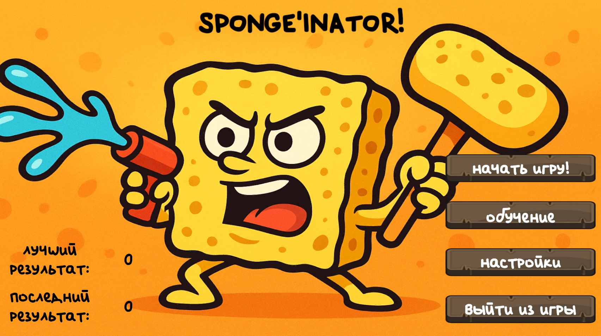
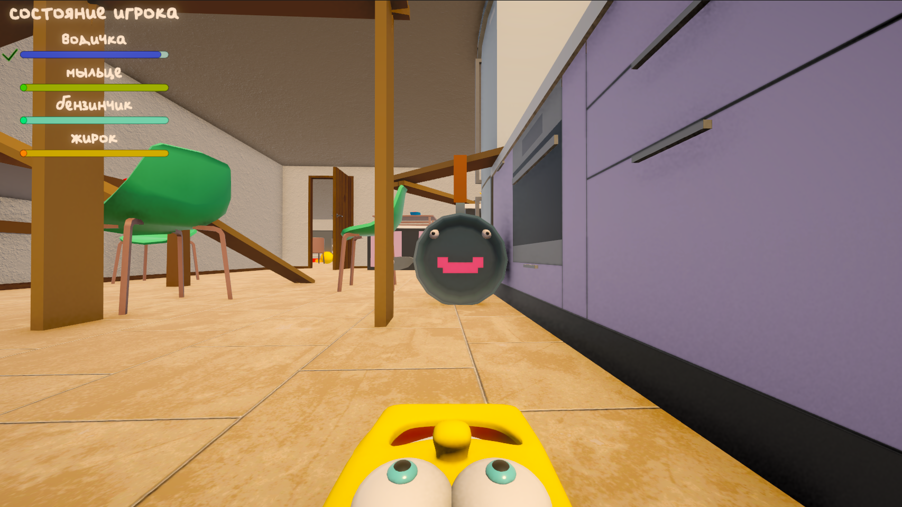
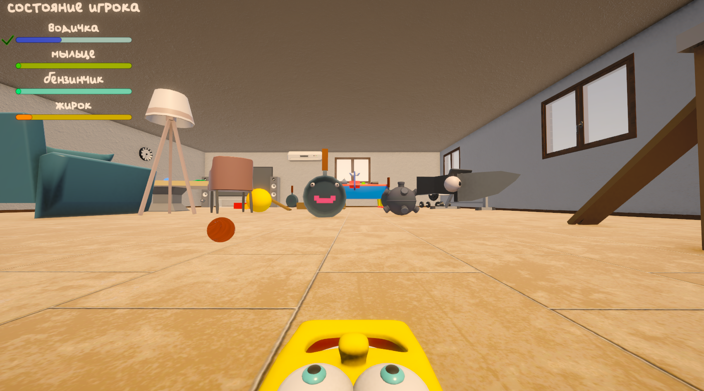

# 🧽 JunkJam — *Sponge'inator*

**Злая губка объявляет войну грязи.** Хватай водяной пистолет, бери напарника-губку покрупнее и отмывай локации от полчищ хлама.

---

## 🎮 Об игре

**JunkJam** — это динамичный экшен от первого лица, где вы играете за боевую губку. Мир захламлён: жир, грязь и мусор наступают волнами, а единственный, кто может навести чистоту — это вы. Меняйте «боевые жидкости» на лету, отбивайтесь от врагов и зачищайте локацию волна за волной.

Главный герой — не обычная губка. Он **пружинит и сплющивается** как желе при движении, впитывает жир (который замедляет его) и огрызается голосом на каждое действие. Чистота ещё никогда не была такой агрессивной.

---

## 📸 Скриншоты

> Слева вверху — панель **«состояние игрока»**: запас водички, мыльца, бензинчика и налипшего жирка. Круглые чумазые враги наступают по всей квартире — только губка наведёт порядок.

---

## ✨ Ключевые особенности

- 🧪 **Три боевые жидкости** — Вода, Чистящее средство и Бензин (огнемёт). Переключайся мгновенно под ситуацию.
- 🌊 **Желейная физика губки** — фирменный wobble/squish-эффект при беге и прыжках.
- 🛢️ **Система впитывания** — жир налипает и замедляет губку, воду и грязь нужно смывать.
- 🌊 **Волновой геймплей** — враги приходят волнами, счётчик отслеживает прогресс до полной зачистки.
- 🗺️ **Три уровня сложности** — Лёгкая, Нормальная и Хардкорная локации + обучение.
- 🔊 **Озвученный герой** — губка комментирует бой, добычу и победы над врагами.
- 🏆 **Подсчёт очков** — каждый уничтоженный враг идёт в счёт.

---

## 🕹️ Управление

| Действие | Клавиша |
|---|---|
| Движение | `W` `A` `S` `D` |
| Прыжок | `Space` |
| Обзор камеры | Мышь |
| Атака / выстрел | `ЛКМ` |
| Вода | `1` |
| Чистящее средство | `2` |
| Бензин (огнемёт) | `3` |
| Смена жидкости по кругу | `Q` |
| Меню паузы | `Esc` |

Чувствительность мыши и громкость музыки и эффектов настраиваются в меню — игра запоминает ваши значения.

---

## 🧪 Арсенал жидкостей

| Жидкость | Клавиша | Как работает |
|---|---|---|
| 💧 **Водичка** | `1` | Зажмите `ЛКМ` — вперёд бьёт струя воды |
| 🧼 **Мыльце** | `2` | Нажмите `ЛКМ` — губка выстреливает едкой пеной, которая отбрасывает врага |
| 🔥 **Бензинчик** (огнемёт) | `3` | Зажмите `ЛКМ` — непрерывное пламя. Не жгите без остановки: огнемёт перегревается и после остывания снова готов к бою |

Запас каждой жидкости ограничен — следите за панелью **«состояние игрока»** и выбирайте оружие под ситуацию.

> **Жирок** 🛢️ — главная угроза: попав в губку, он налипает, замедляет её и делает скользкой. Не стойте на месте под обстрелом!

---

## 👾 Враги

- **Стрелки** держат дистанцию и закидывают вас навесом комками жира.
- **Камикадзе** несутся на вас и бьют при контакте.
- **Патрульные** обходят комнаты и бросаются в погоню, как только заметят вас.

Берегитесь и самой квартиры: раскалённая плита тоже наносит урон.

---

## 🗺️ Уровни

Уровень пройден, когда не осталось ни одного врага.

- 📘 **Обучение** — враги выходят волнами, пока вы осваиваете управление и жидкости.
- 🟢 **Лёгкий уровень** — разогрев для новичков.
- 🟡 **Нормальный уровень** — сбалансированный вызов.
- 🔴 **Хардкор** — для настоящих чистюль.

---

## 💡 Советы

- Не ограничивайтесь одной жидкостью: переключайтесь на лету (`1`/`2`/`3` или `Q`).
- Не держите огнемёт до перегрева — оставляйте запас на опасный момент.
- Двигайтесь и прыгайте: стоящая губка — лёгкая мишень для жира.
- Если запас жидкости кончился, поменяйте оружие.

---

## 🛠️ Для разработчиков

Игра сделана на **Unity 6.2** (`6000.2.9f1`), C#, Universal Render Pipeline; поддерживаются сборки под Windows и WebGL.

Запуск из исходников: откройте корень репозитория в Unity Hub, откройте сцену `Assets/Scenes/MainMenu.unity` и нажмите **Play**. Сборка — через **File → Build Settings** (список сцен уже настроен). Скрипты геймплея лежат в `Assets/Scripts/`, сторонние ассеты — в `Assets/Content`, `Assets/NamuFX`, `Assets/UnityTechnologies`.

---

*Сделано с 🧽 и ненавистью к грязи.*

